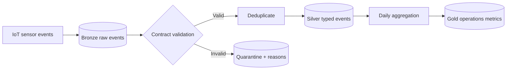

# WasteStream Lakehouse

[](https://github.com/Rajesh-444/waste-stream-lakehouse/actions/workflows/ci.yml)


A contract-driven data pipeline for smart-bin telemetry. It turns noisy sensor events into a medallion-style lakehouse with immutable bronze records, validated silver events, quarantined failures, and gold operational metrics.

## The data problem

IoT feeds arrive late, contain duplicate events, and sometimes report impossible values. A dashboard should never silently treat those records as truth. This project makes every quality decision auditable.



## Run locally

The reference pipeline uses only the Python standard library:

```bash
PYTHONPATH=src python -m waste_lakehouse.pipeline \
  --input data/sample_sensor_events.csv \
  --output build

PYTHONPATH=src python -m unittest discover -s tests -v
```

The repository also includes `databricks/medallion_job.py`, a PySpark implementation of the same contract for a Databricks workflow.

## Quality rules

- `event_id` and `sensor_id` are required
- timestamps must use ISO 8601
- fill percentage must be between 0 and 100
- temperature must be between -30 and 100 C
- duplicate `event_id` values are quarantined
- rejected rows retain contract fields and validation reasons; unexpected fields are removed

## AI and data safety guardrails

| Control | Behavior |
| --- | --- |
| Contract allowlist | Blocks fields outside the declared sensor-event schema, preventing accidental PII propagation |
| Location minimization | Rounds coordinates to two decimals before bronze or silver persistence by default |
| Explicit override | Exact coordinates require the visible `--allow-precise-location` flag |
| Quarantine | Invalid and duplicate events remain outside analytics tables with auditable reasons |
| Human decision boundary | Gold alerts are decision-support signals; the pipeline does not automatically dispatch or penalize operators |

The demo is safe by default. A production lakehouse should additionally enforce catalog permissions, encryption, retention policies, lineage, and human approval before operational automation.

## Recruiter walkthrough

1. Start with `contracts/sensor_event.schema.json` to see the source contract.
2. Read `pipeline.py` to follow validation, deduplication, and aggregation.
3. Run the tests to see invalid ranges and duplicate events handled explicitly.
4. Compare the local implementation with the included PySpark job.

## Production roadmap

- Auto Loader ingestion with checkpoints and schema evolution
- Delta Live Tables expectations and Unity Catalog lineage
- Watermarks for late events and idempotent merge keys
- Great Expectations or Deequ quality history
- Power BI operational dashboard over gold tables

